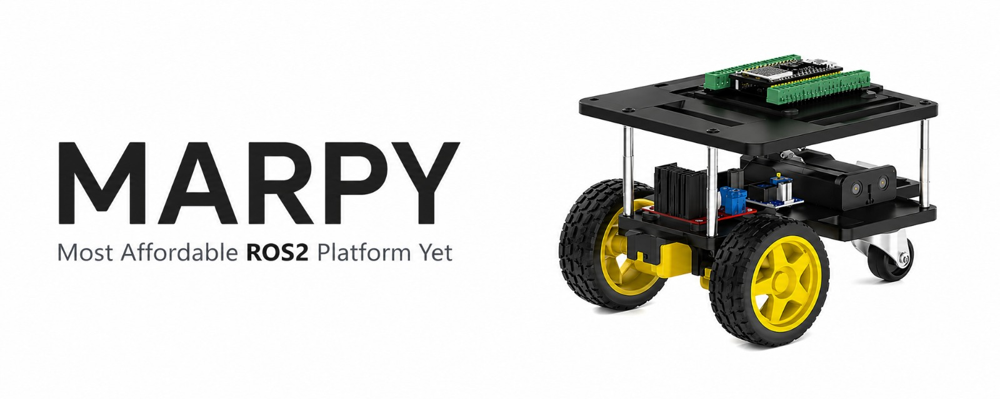
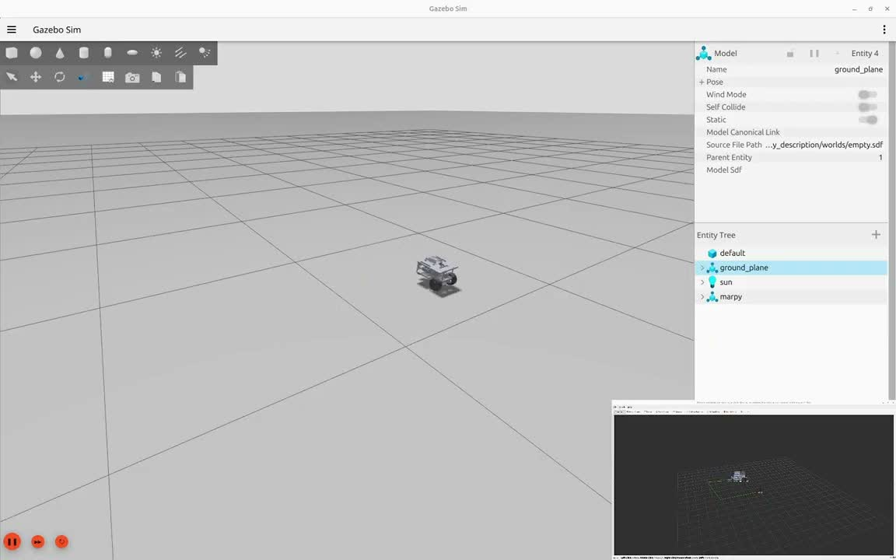

<div align="center">

[](https://ubuntu.com/) [](https://docs.ros.org/en/jazzy/) [](https://micro.ros.org/) [](LICENSE)

</div>

# Autonomous Mobile Robot

Autonomous Mobile Robot is a ROS 2 differential-drive robot project. Its robot design, build documentation, and parts of its software extend the [MARPY project](https://github.com/LevinTamir/MARPY). This repository renames and updates the ROS packages and workspace, adds arrow-key teleoperation, and documents setup and simulation changes. Upstream remains credited as the source of reused work and design materials. See [setup notes](docs/setup-notes.md) for the tested Ubuntu 24.04 ARM64 setup.

<p align="center">
  
</p>

---

## Requirements

- Ubuntu 24.04
- ROS2 Jazzy (or Docker)
- PlatformIO and a 2.4 GHz WiFi network are needed only for physical ESP32 hardware. Simulation needs neither.

## Quick Start

### 1. Clone the workspace

```bash
git clone https://github.com/Dharun235/Autonomous-Mobile-Robot.git
cd Autonomous-Mobile-Robot
```

### 2. Build the robot hardware (optional)

Follow the guides in order:

| Step | Guide | Description |
|------|-------|-------------|
| 1 | [Bill of Materials](docs/bom.md) | Get parts |
| 2 | [Assembly Instructions](docs/assembly.md) | Build the robot |
| 3 | [Wiring Guide](docs/wiring.md) | Connect electronics |

After software setup, follow [Firmware Setup](docs/firmware-setup.md) to flash the upstream ESP32 firmware.

### 3. Install dependencies and build workspace

Choose [Docker setup](docs/ros2-setup.md#option-a-docker-recommended-for-beginners) or [native ROS 2 setup](docs/ros2-setup.md#option-b-native-installation). The native guide installs workspace tools, resolves ROS dependencies with `rosdep`, and builds all packages.

### 4. Run simulation or drive hardware

For simulation, follow the [Gazebo guide](docs/simulation.md). Simulation needs no robot hardware.

For physical robot, start the agent, launch the robot, and run arrow teleop in separate terminals. Source ROS 2 and workspace setup in each terminal:

```bash
# Terminal 1: Start the micro-ROS agent
docker run -it --rm --net=host microros/micro-ros-agent:jazzy udp4 --port 8888 -v6

# Terminal 2: Launch the real robot (robot_state_publisher, odometry, RViz)
source /opt/ros/jazzy/setup.bash
source install/setup.bash
ros2 launch autonomous_mobile_robot_bringup real.launch.py

# Terminal 3: Drive with arrow keys (workspace must be built and sourced)
source /opt/ros/jazzy/setup.bash
source install/setup.bash
ros2 run autonomous_mobile_robot_bringup arrow_teleop.py
```

## Repository Structure

```
Autonomous-Mobile-Robot/
├── README.md               ← You are here
├── docs/
│   ├── bom.md              ← Bill of materials + purchase links
│   ├── assembly.md         ← Step-by-step build guide
│   ├── wiring.md           ← Wiring diagram + pin tables
│   ├── firmware-setup.md   ← Flash the ESP32
│   ├── ros2-setup.md       ← Dependencies, workspace build, micro-ROS agent
│   └── images/             ← Robot photos and diagrams
├── src/
│   ├── autonomous_mobile_robot_description/  ← URDF model + meshes + Gazebo worlds
│   ├── autonomous_mobile_robot_localization/ ← Wheel odometry + path tracking
│   ├── autonomous_mobile_robot_cam_bridge/   ← Optional camera image bridge
│   └── autonomous_mobile_robot_bringup/      ← Launch files (sim + real)
├── docker/
│   ├── docker-compose.yml  ← micro-ROS agent + dev container
│   ├── Dockerfile          ← ROS2 Jazzy dev environment
│   └── entrypoint.sh
└── .github/workflows/      ← CI/CD pipeline
```

## Simulation Demo

[](https://youtu.be/tEwZcNDOt3I)

## ESP32 Firmware Sources

ESP32 firmware is maintained in the original upstream repositories. Their repository names and clone paths remain unchanged; this repository does not claim them as renamed or independently maintained code:

- **[Upstream ESP32 drive firmware](https://github.com/LevinTamir/marpy_firmware)** - PlatformIO project for micro-ROS, motor control, encoder reading, and IMU.
- **[Upstream ESP32 camera firmware](https://github.com/LevinTamir/marpy_cam_firmware)** (optional) - Serves an MJPEG stream, republished as `sensor_msgs/Image` by this repository's camera bridge.

See [firmware setup](docs/firmware-setup.md) for flashing instructions and upstream attribution.

## Contributing

Contributions are welcome! If you build this robot, open an issue with photos so everyone can see it.
